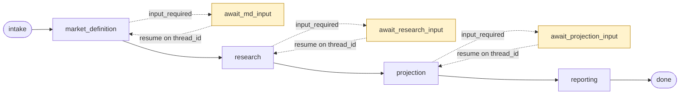
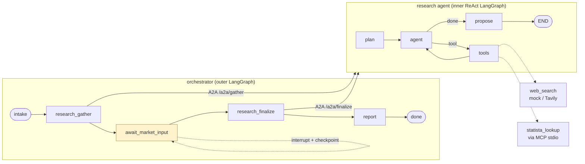

# LangGraph HITL Reference

A small, runnable reference implementation of a **resumable, human-in-the-loop
multi-agent pattern**: an orchestrator (outer LangGraph) that dispatches to a
research agent (inner ReAct graph) over an **A2A** service boundary, pauses for human
approval via a durable **checkpoint**, and resumes on the same `thread_id`.

It's a teaching slice — scripted model, mock web search, a local stub MCP server — so
it runs offline with no cloud and no API keys. The production integrations (Entra/JWT
auth, managed identity, Azure OpenAI, Postgres checkpointing, real search, real MCP)
are present as clearly-marked, swappable code paths.

> This repo is a generic reference I wrote to demonstrate the mechanics. It is not any
> employer's code. The architecture below is my own design.

---

## The architecture (the design under discussion)

The full system this pattern comes from is a four-stage market-sizing pipeline:



Each stage is its own containerized A2A service behind an orchestrator. The orchestrator
doesn't know how a specialist does its job — it sends a scoped message and listens for
`input_required` or `completed`. Every `await_*_input` is a durable pause: the state is a
Postgres checkpoint keyed by `thread_id`, so a run can wait overnight and resume exactly
where it stopped.

## What this repo implements (a vertical slice)

To keep it readable and locally demoable, this repo implements **one specialist**
(research) end to end, with the human-in-the-loop pause between gather and finalize:



---

## Run it

```bash
pip install -e '.[dev]'     # offline demo deps only
make demo                   # in-process: watch it pause at INPUT_REQUIRED, then resume
make test                   # smoke test (pause/resume + validation)
```

Full two-service HTTP topology (real A2A hop + bearer auth), in containers:

```bash
make up                     # orchestrator :8080  +  research_agent :8081
make demo-http              # drives /invoke -> input_required -> /resume
```

---

## The patterns, and where to read each one

| Pattern | What to look at |
|---|---|
| **Outer graph + the HITL pause** | `orchestrator/graph.py` — `await_market_input` calls `interrupt()`; resume via `Command(resume=...)` in `orchestrator/main.py` |
| **Durable checkpointing (memory)** | `common/checkpoint.py` — SQLite local / Postgres prod, same `BaseCheckpointSaver` interface |
| **A2A service boundary** | `common/a2a.py` (contract + `TaskState.INPUT_REQUIRED`), `orchestrator/clients.py` (inproc vs http), `research_agent/main.py` (the service) |
| **ReAct agent as explicit nodes** | `research_agent/graph.py` — `plan → agent ⇄ tools → propose` |
| **Web search tool** | `research_agent/tools/web_search.py` — mock / Tavily, output treated as untrusted |
| **MCP client + server** | `research_agent/tools/mcp_client.py` + `mcp_server/statista_stub.py` (stdio) |
| **Gateway auth (JWT) + managed identity** | `common/auth.py` — inbound Entra JWT validation; outbound service token |
| **Provenance + validation** | `research_agent/model.py` (source tagging), `research_agent/graph.py` `finalize()` (low ≤ base ≤ high) |

### Auth, specifically (the part worth asking about)

Two directions of trust, both in `common/auth.py`:

1. **Inbound (user → orchestrator):** OAuth2 **Bearer / JWT**. In production the token is an
   Entra ID access token; Azure Container Apps *Easy Auth* validates it at the edge and we
   also validate in-app (verify RS256 signature against the tenant **JWKS**, check audience +
   issuer). In dev it's a shared bearer token so the demo needs no cloud.
2. **Service-to-service (orchestrator → research agent):** the caller presents **its own**
   identity via a **managed identity** (`DefaultAzureCredential`) — no stored secret. In dev
   it's the same shared token.

### Why the LLM never does the math

`finalize()` enforces `low ≤ base ≤ high` as a hard check, and every assumption carries a
`source_status` (`research_value | support_range | heuristic_fallback`). The model proposes
structured numbers; code validates them. A heuristic fallback is allowed but must *declare
itself*, so nothing untraceable reaches the report.

---

## Swapping in production

Everything is env-driven (`.env.example`):

| Knob | Local | Production |
|---|---|---|
| `AUTH_MODE` | `dev` | `entra` |
| `CHECKPOINT_BACKEND` | `sqlite` | `postgres` |
| `MODEL_BACKEND` | `scripted` | `azure_openai` |
| `SEARCH_BACKEND` | `mock` | `tavily` |
| `MCP_ENABLED` | `false` | `true` |
| `RESEARCH_MODE` | `inproc` | `http` |

Install the prod integrations with `pip install -e '.[azure,mcp]'`.
